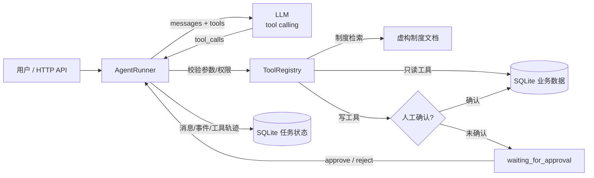

# 企业 IT 服务台与资产支持 Agent

> 一个可以真实完成多步骤任务的 Agent：模型自主选择工具、程序真实执行、结果回灌模型、写操作必须人工确认。
> 全部业务数据与制度文件均为虚构，不连接任何真实企业系统。

[](https://github.com/haozhouliuliuliu/it-service-desk-agent/actions/workflows/ci.yml)
[](https://www.python.org/)
[](LICENSE)

## 业务场景

IT 服务台每天收到大量重复请求：查库存、查设备领用人、查工单进度、新员工领电脑、改工单优先级。其中一部分可以直接查询，一部分必须走人工确认，还有一部分信息不全，需要先问清楚。

这个项目把服务台处理流程做成一个可执行的 Agent：

- 模型根据用户请求和工具返回结果，自己决定下一步查什么；
- 程序负责工具白名单、参数校验、状态机、上限和人工确认；
- 写操作没有确认凭证一律拒绝，重复确认不重复写入。

它适合作为企业内部 IT 服务台、共享服务中心的 Agent 原型，也适合演示「让模型做判断，但不让模型直接动数据」的落地方式。

## 交付内容

| 能力 | 实现 |
|---|---|
| 动态多步骤 | 模型自主选择工具，结果回灌后继续决策 |
| 业务工具 | 库存、设备、工单、制度检索共 7 个工具 + 1 个澄清工具 |
| 状态与审计 | SQLite 任务/消息/事件/工具调用/确认记录，可回放 |
| 人工确认 | 写操作挂起，approve/reject 后才执行；参数绑定，重复确认幂等 |
| 边界控制 | 工具白名单、参数校验、工具/模型轮次上限、超时重试 |
| HTTP API | 创建任务、查询、补充输入、确认、事件与轨迹 |

## 与"固定工作流"的区别

本项目的执行顺序由模型根据工具返回结果动态决定，而不是代码里写死的步骤：

```text
用户任务 → 模型选择下一步
              ├─ 调用工具 → 程序校验/执行 → 结果回灌 → 模型再决定
              ├─ 请求澄清 → 任务挂起 → 用户补充 → 继续
              ├─ 申请写操作 → 挂起等人工确认 → 确认后仅执行该操作
              └─ 输出最终答复 → 完成
```

程序负责：工具白名单、参数校验、权限判断、状态流转、事件记录、执行上限与失败处理。
模型只能"提议"，不能直接触碰数据库、文件系统或系统命令。



## 已实现的工具（7 个业务工具 + 1 个控制工具）

| 工具 | 类型 | 说明 |
|---|---|---|
| `search_policies` | 只读 | 检索虚构制度文件，返回文档标题、片段与出处 |
| `query_inventory` | 只读 | 按设备类别查询库存与可用数量 |
| `get_asset` | 只读 | 按设备编号/领用人查询设备状态 |
| `get_ticket` | 只读 | 查询工单详情 |
| `list_tickets` | 只读 | 按状态/处理人列出工单 |
| `create_ticket` | 写入 | 创建工单，必须人工确认 |
| `update_ticket` | 写入 | 修改工单状态/优先级，必须人工确认 |
| `request_user_input` | 控制 | 信息不足时向用户提问，任务进入 `waiting_for_input` |

## Agent 循环

```text
用户任务 → 模型 → tool_calls → 程序校验/执行 → 结果回灌 → 模型再决定
                ├─ 只读工具：执行后继续
                ├─ 写工具：挂起等待人工确认，确认后只执行该操作
                ├─ request_user_input：挂起等待用户补充
                └─ 无 tool_calls 且有内容：完成
```

| 硬约束 | 值 |
|---|---|
| 单任务工具调用上限 | 8 次（超出 → `limit_reached`） |
| 单任务模型交互上限 | 12 轮（超出 → `limit_reached`） |
| LLM 传输重试 | 2 次（仅超时/连接/429/5xx） |
| 写操作 | 无 `ApprovalToken` 一律拒绝 |
| 重复写操作 | 同任务同工具同参数复用确认结果，不重复写入 |

状态：`running / waiting_for_input / waiting_for_approval / completed / failed / limit_reached`。
进程重启时遗留 `running` 会标记为 `failed(INTERRUPTED)`，需显式 `resume`，不谎称自动恢复。

任务、消息、事件、每次工具调用与确认记录全部落 SQLite，可用 `it-agent task <id>` 回看。

## 固定测试集与真实评估

- **30 例固定集**：直接查询 5 / 多步骤 8 / 澄清 4 / 写确认 4 / 失败与上限 4 / 安全注入 5；
- **26 例真实模型**通过真实 HTTP API 执行，4 例脚本化模型专测程序上限与异常路径；
- 判定基于状态、工具调用、数据库副作用、关键文本，不依赖模型措辞；
- 证据：`evidence/real-model/<run_id>/`（模型配置、完整轨迹、判定、报告）。

最近一次真实运行（`deepseek-flash`，temperature=0）：

```
真实模型：26/26
多步骤：  8/8
全部：    30/30
```

最终运行与安全结论见 [docs/testing.md](docs/testing.md)。

```bash
# 需要 LLM_API_KEY；不会在证据中写入密钥
python -m eval.harness --output evidence/real-model
```

## Docker 部署

```bash
export LLM_API_KEY=sk-...        # 真实任务必需；只注入环境变量
docker compose up --build -d
curl http://127.0.0.1:8000/healthz
```

- 镜像基于 `python:3.12-slim`，非 root（uid 10001），内置 healthcheck；
- SQLite 与任务数据在命名卷 `agent-data`，重启后历史仍在；
- 单 worker 运行（任务锁与 SQLite 为单进程设计），不要加 `--workers`；
- CI 会真实构建镜像、启动容器并检查 `/healthz`、`/api/tools` 与运行用户。

## 能力与证据

| 要求 | 证据 |
|---|---|
| Agent 循环、动态多步骤 | `src/it_agent/agent/runner.py`；`evidence/real-model/*/cases.json` 工具轨迹 |
| 7 业务工具 + 控制工具 | `src/it_agent/tools/`、`it-agent tools --json`、`docs/tools.md` |
| 工具真实执行、参数校验 | `tests/test_tools.py`（未知工具/非法参数/权限） |
| 状态、持久化、历史 | SQLite 表 `tasks/messages/events/tool_calls/approvals`；`GET /events`、`/tool-calls` |
| 人工确认、幂等写入 | `tests/test_agent_loop.py`、`tests/test_api.py`；重复确认不重复写 |
| 上限、超时、有限重试 | `tests/test_agent_loop.py`；固定集 F1–F4 |
| 自动化测试 ≥20 | **134 passed**，覆盖率 92% |
| 真实模型 ≥10 次 / ≥5 多步骤 | **26 次真实 / 8 次多步骤，26/26、8/8** |
| 固定测试集 30 例 | `eval/cases.json`、`docs/testing.md` |
| Docker 与文档 | `Dockerfile`、`docker-compose.yml`、`docs/*.md` |
| 已知限制 | `docs/known-limitations.md` |

## 数据声明

- 公司名、员工、设备编号、工单、制度文件全部虚构；
- 不包含真实密钥；LLM API key 只从环境变量读取，仓库只提供 `.env.example`；
- 不执行任何真实资产变更、付款或采购操作。

## 快速开始

```bash
python -m venv .venv
.venv\Scripts\activate
pip install -e ".[dev]"

# 1) 用 seed_data 初始化 SQLite（虚构员工/资产/工单）
it-agent init-db

# 2) 查看注册的工具（含参数 schema）
it-agent tools --json

# 3) 检索制度
it-agent search "新员工 电脑 领用"

# 4) 真实模型跑一个任务（需要 LLM_API_KEY，见 .env.example）
it-agent run "现在笔记本电脑还有多少可用库存？"

# 5) 回看轨迹 / 处理待确认
it-agent task <task_id>
it-agent approve <task_id> <approval_id> --by 张会计
it-agent reject  <task_id> <approval_id> --by 张会计
it-agent input   <task_id> "补充信息"

# 6) 启动 HTTP API
it-agent serve

# 7) 自动化测试 + 固定集评估（评估需要 LLM_API_KEY）
pytest -q
python -m eval.harness --output evidence/real-model
```

数据说明：

- `seed_data/`：虚构制度 Markdown、14 名员工、30 台设备、20 条工单；
- `data/agent.db`：运行期 SQLite（已 gitignore），由 `init-db` 生成；
- 库为空时才导入种子数据，运行期新建的工单不会被种子覆盖。

## 适用场景与可复用产出

- **业务流程梳理**：把“查库存/查设备/查工单/建单/改单”拆成工具、权限、确认点和失败路径；
- **Agent 落地**：模型负责选择下一步，程序负责校验与执行，避免模型直接动数据库；
- **人工确认**：写操作参数绑定确认凭证，重复确认不重复写入；
- **可复用材料**：8 个工具 schema、30 例固定测试集、真实模型 harness、Docker 部署；
- **可演示**：任务状态、工具轨迹、确认记录和工单副作用都能从 API/SQLite 回看。

## 文档

- 工具手册：`docs/tools.md`
- 架构与数据流：`docs/architecture.md`
- HTTP API：`docs/api.md`
- 测试报告：`docs/testing.md`
- 真实模型评估：`evidence/real-model/`
- 已知限制：`docs/known-limitations.md`

## 许可

[MIT](LICENSE)
